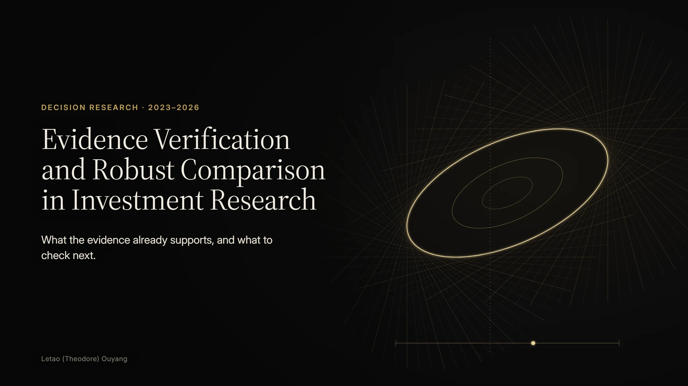
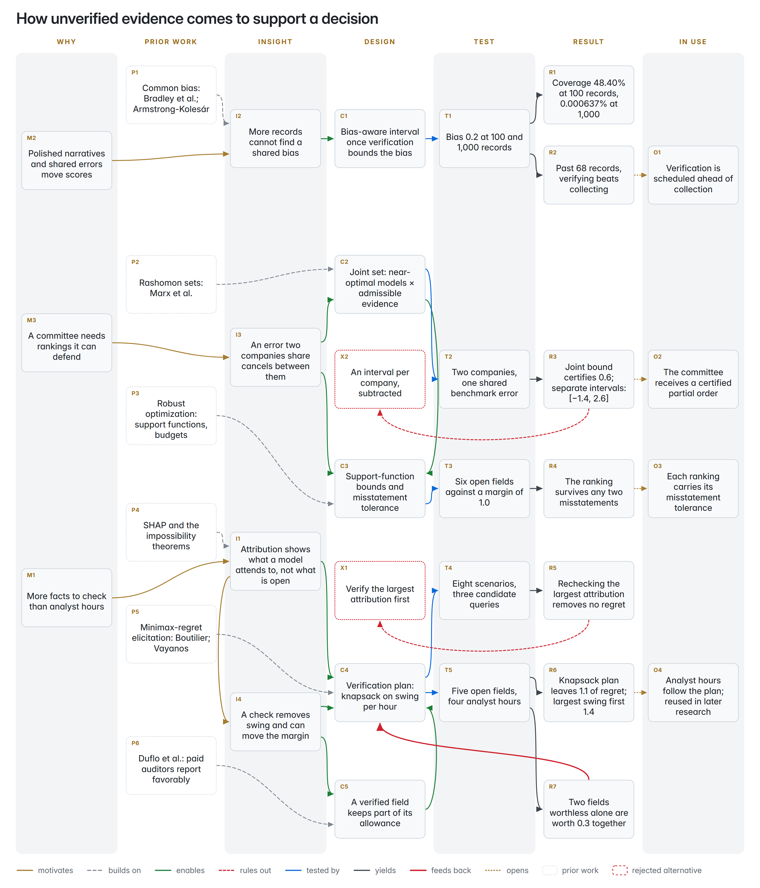

<p align="center"></p>

# Evidence Verification and Robust Comparison in Investment Research

**Letao (Theodore) Ouyang** · Researcher · Duke University × Leading Global Alternative Asset Manager · September 2023 – September 2026

[Article](manuscript/evidence-verification-and-robust-comparison-in-investment-research.md) · [PDF](paper/paper.pdf) · [Results](reproduce/results.md) · [Derivations](docs/derivations.md) · [Design notes](docs/design-notes.md) · [Research route](docs/research-route.md) · [Literature](docs/literature.md)

**Which investment conclusions does the evidence in hand already support, and which fact is most valuable to verify next?**

Due diligence has more facts to check than analyst time to check them. I built a method that answers both
questions, with ranking guarantees that hold across every near-optimal scoring model and every admissible
resolution of the unverified evidence and need no probability that any particular disclosure is exaggerated. For
affine scores I solved the verification problem exactly: a field has guaranteed value only when its unresolved
swing exceeds the current margin, and a plan over many fields is a knapsack on swing per unit of analyst cost. I
implemented the method with a leading global alternative asset manager, which has more than $300 billion in assets
under management, and subsequent research reused it.

## Three results to start with

| Result | Why it matters | Where |
| --- | --- | --- |
| Verifying a set of fields with combined swing $`s_J`$ leaves worst-case regret $`(h - \max(s_J, \left\lvert m\right\rvert))_+`$. With four analyst hours the knapsack plan leaves **21%** less regret than checking the largest field | A field counts only if it could reverse the decision, fields worthless alone are valuable together, and the plan is computed, not judged | [§4, §6](manuscript/evidence-verification-and-robust-comparison-in-investment-research.md) · [D9](docs/derivations.md#d9-the-exact-plan-for-affine-scores) |
| A joint error model certifies a **0.6-point** advantage that separately built company intervals, $`[-1.4, 2.6]`$, cannot show | An error two companies share cancels between them. One inclusion event certifies every pair at once, so the output is a certified partial order that verification can only extend | [§2, §3](manuscript/evidence-verification-and-robust-comparison-in-investment-research.md) · [D4](docs/derivations.md#d4-one-event-certifies-every-pair) · [D5](docs/derivations.md#d5-support-functions-and-the-cancellation-of-shared-errors) |
| Under a shared reporting bias a nominal 95% interval covers the truth **48.40%** of the time at 100 records and 0.000637% at 1,000. Past $`n^* \approx 68`$ records, verification is the better use of the next analyst hour | More data cannot find a bias common to all records. The threshold says when to stop collecting | [§1, §6](manuscript/evidence-verification-and-robust-comparison-in-investment-research.md) · [D2](docs/derivations.md#d2-common-bias-the-bias-aware-interval-and-when-to-stop-collecting) |

All 48 figures in the article are recomputed in [results](reproduce/results.md).

## The problem

AI-polished narratives, unverified sustainability claims and common reporting errors can all move ESG and
investment scores. The usual guide to what deserves checking is feature attribution, which measures what the model
cares about. A diligence team needs to know something else: which evidence is still open and able to change the
decision. For a linear score with unresolved errors $`\left\vert\delta_j\right\vert \le d_j`$,

```math
\phi_j = \beta_j\,(x_j - E_Q X_j), \qquad \sup_{\left\vert\delta_j\right\vert \le d_j} \left\vert f(x+\delta) - f(x)\right\vert = \sum_j \left\vert\beta_j\right\vert\, d_j .
```

The attribution depends on where a feature sits relative to the background, and the worst-case change depends on
how wide the errors are. An audited metric can have a large attribution and nothing left to resolve; a
self-reported metric near the sector mean can have a near-zero attribution and enough unresolved error to reverse
a ranking.

## The idea

**One joint set.** Unresolved evidence $`𝒳(E)`$ is represented jointly for all companies, together with
the set $`ℱ_\alpha`$ of near-optimal scoring models: $`\Omega(E) = ℱ_\alpha \times 𝒳(E)`$.
A ranking is certified when its lower bound over the whole set is positive.

**Three outputs a committee can act on.**

| Output | Definition | What it says |
| --- | --- | --- |
| The certified partial order | Pairs with $`\underline{\Delta}_{ik} > 0`$ over $`\Omega(E)`$ | These rankings hold whatever the unverified evidence turns out to be |
| Misstatement tolerance | $`\Gamma^*_{ik} = \max\{\Gamma : \sum_{j \le \Gamma} s_{(j)} < m_f\}`$ | This ranking holds against any $`\Gamma^*`$ unverified fields being wrong at once |
| The verification plan | The set $`J`$ that minimizes $`(h - \max(s_J, \left\lvert m\right\rvert))_+`$ within the analyst budget | These are the fields to check with the hours available |

Here $`s_j = \left\vert a_{f,j}\right\vert\,d_j`$ is the *swing* of field $`j`$, the most its unresolved state can move the comparison,
$`h`$ is the total swing and $`m`$ the current margin.

**Why the plan has a closed form.** Verification acts twice. It removes $`s_J`$ of swing, and it can move the
margin by as much as $`s_J`$ against the current leader. Until $`s_J`$ exceeds $`\left\vert m\right\vert`$ the two effects cancel in
the worst case. Four results follow:

- **The pivot rule.** A single field has guaranteed value only if its swing exceeds the margin.
- **Complementarity.** Two fields that are each worthless alone are worth $`s_J - \left\vert m\right\vert`$ together.
- **The plan is a knapsack** on swing per unit of analyst cost.
- **Shared sources are worth nothing to a pairwise choice.** Hours spent on the benchmark two companies share
  cannot move the choice between them.

## Results

Company data and operating figures are withheld under the nondisclosure agreement. Every numerical result is a
worked example with its inputs stated.

**A verification plan under an analyst budget.** One company leads another by 0.6 score points. Five fields are
unresolved, with swings 0.9, 0.5, 0.4, 0.3, 0.2 and costs of 4, 1, 2, 1, 1 analyst hours. With four hours:

| Plan | Fields verified | Hours | Regret remaining |
| --- | --- | ---: | ---: |
| Before verification | none | 0 | 1.7 |
| Largest swing first | 1 | 4 | 1.4 |
| **Swing per hour (the knapsack plan)** | 2, 3, 4 | 4 | **1.1** |

**Regret-based selection against attribution magnitude.** Eight scenarios from two candidate models and four
evidence configurations, one query at equal cost:

| Verification query | Regret remaining | Guaranteed reduction |
| --- | ---: | ---: |
| Recheck the verified field with a large attribution | 0.61 | 0 |
| Verify the smaller unresolved variable | 0.61 | 0 |
| **Verify the variable that sets the sign of the difference** | **0** | **0.61** |

**Shared errors.** A nominal difference of 0.6 and a shared sector-benchmark error in $`[-1, 1]`$: separately
built intervals give $`[-1.4, 2.6]`$, and the joint calculation gives $`[0.6, 0.6]`$.

**Misstatement tolerance.** A ranking with margin 1.0 and six open fields with swings 0.4, 0.3, 0.3, 0.2, 0.2, 0.1
is not certified against all six at once, since the swings sum to 1.5. It holds against any two of them.

**Common bias.** With a shared bias of 0.2 a nominal 95% interval covers 48.40% at 100 records and 0.000637% at
1,000. Once verification bounds the bias, the bias-aware half-width is 0.3645 against 0.396 for the widened
interval, 8.0% shorter at exactly 95%.

**Selection.** Choosing five of twenty companies needs 75 certificates, in place of all 190 pairs.

## What is new

Support functions, budgeted uncertainty sets, Rashomon sets and minimax regret are established tools. What I
built:

1. **Due diligence as a decision problem over a joint set.** Model multiplicity and unresolved evidence in one
   object, with errors shared across companies. Rashomon-set methods vary the model and take the inputs as known;
   certain-prediction methods vary the data and treat rows as independent.
2. **The exact verification plan for affine scores.** The closed form for the regret that remains, the pivot
   rule, complementarity and the knapsack. Minimax-regret elicitation chooses questions about preferences by
   mixed-integer programming; here the questions are facts and the answer is a formula.
3. **A certified partial order that costs nothing in the number of pairs.** One inclusion event, monotone under
   verification, with the share of certified pairs as the measure of progress.
4. **Misstatement tolerance as the reported number.** The budgeted uncertainty set read in the other direction.
5. **The threshold between collecting and verifying.** $`n^* = (1.645\,\sigma/\bar b)^2`$, from the bias-aware
   critical value.
6. **Assurance tiers in the plan.** A verified field keeps a fraction of its allowance set by the standing of the
   source, and the swing actually removed is what enters the knapsack.

[Where this work sits](docs/literature.md) sets each of these against the closest prior work, and the
[bibliography](docs/bibliography.md) lists all 172 sources.

## How the argument was built

<picture>
  <source media="(prefers-color-scheme: dark)" srcset="assets/route-dark.png">
  
</picture>

The route is a network. The error model, the ranking bounds and the verification plan were worked out against each
other, and three results went back and changed the design.

- **What more data cannot fix.** A shared bias has to be bounded by verification, and the same calculation says
  when to stop collecting.
- **Rankings that hold whatever the open evidence turns out to be.** The shared-error example ruled out an
  interval per company.
- **What to verify next.** The eight-scenario example ruled out attribution magnitude as a work list, and the
  finding that fields are valuable in sets turned a rule for single queries into a plan.

The [research route](docs/research-route.md) explains all 36 steps and all 37 links.

## In production

- I implemented the framework with a leading global alternative asset manager, and subsequent research reused it.
- I turned institutional diligence requirements into measures of score reliability, pairwise ranking stability and
  verification priority.
- The workflow ingests evidence, scores companies across the near-optimal model set, computes the certified partial
  order and its tolerances, and allocates verification by the plan. Each correction triggers rescoring and a
  recomputation check, so the investment committee has a traceable basis for every conclusion it is shown.
- I converted operating reports, audited financial statements, sustainability disclosures, management
  questionnaires and third-party datasets into structured scoring rules that carry source and version records.

## If you run diligence on scored companies

| If you | The article shows | Do this |
| --- | --- | --- |
| Check the fields the model weighs most | Attribution magnitude and verification value are separate calculations | Rank fields by swing against the margin |
| Build an interval per company and compare | A shared source is counted twice | Model shared sources once and bound the difference directly |
| Score verification queries one at a time | Fields worthless alone are valuable together | Solve the knapsack on swing per analyst hour |
| Collect more records to tighten an estimate | A shared bias does not shrink with the sample | Past $`n^*`$, spend the next hour bounding the bias |
| Report a score with an interval | A committee asks how many things would have to be wrong | Report the misstatement tolerance of each ranking |

## Repository

| Path | Contents |
| --- | --- |
| [`manuscript/`](manuscript/evidence-verification-and-robust-comparison-in-investment-research.md) | The article |
| [`paper/paper.pdf`](paper/paper.pdf) | The article as a PDF |
| [`docs/derivations.md`](docs/derivations.md) | Every proof in full, D1 to D10 |
| [`docs/design-notes.md`](docs/design-notes.md) | Each design choice, the alternative it beat, and what the committee receives |
| [`docs/research-route.md`](docs/research-route.md) | The logic of the work as a network, node by node |
| [`docs/literature.md`](docs/literature.md) · [`docs/bibliography.md`](docs/bibliography.md) | Where the work sits, and the 172 sources |
| [`reproduce/`](reproduce/README.md) | Code that recomputes every figure in the article, and the [results](reproduce/results.md) |

## Disclosure

I conducted this project through a Duke University collaboration with a leading global alternative asset manager.
The partner's name and proprietary system identifiers are withheld under a nondisclosure agreement.
The project title, my role, locations, dates, system architecture and mathematical formulations are cleared for
public disclosure. Company data and operating figures are withheld; every numerical illustration is a worked example with
its inputs stated.

## Citation

Letao (Theodore) Ouyang, *Evidence Verification and Robust Comparison in Investment Research* (Duke University, 2026),
<https://www.theodoreoy.com/experience/evidence-verification-and-robust-comparison-in-investment-research/>. See
[CITATION.cff](CITATION.cff).

[theodore.oy2025@gmail.com](mailto:theodore.oy2025@gmail.com) · [10@alumni.duke.edu](mailto:10@alumni.duke.edu)

© Letao (Theodore) Ouyang. All rights reserved.
