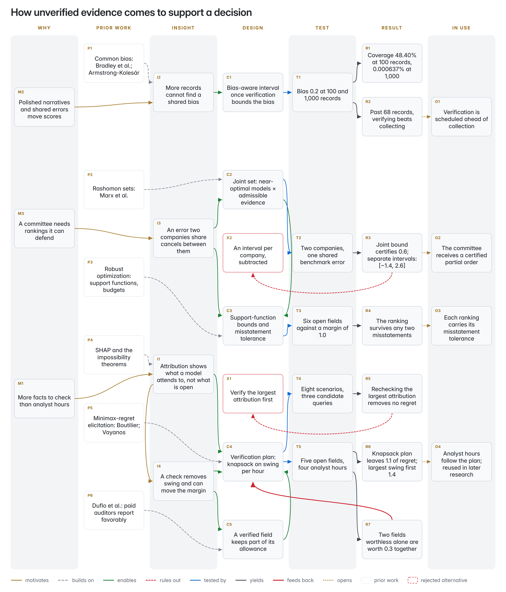

# Research route

How the argument was built: which observation forced which design choice, where a result went back and changed the
design, and what the design became in operation. The work did not run from problem to solution in one line. The
error model, the ranking bounds and the verification plan were worked out against each other, because the plan is
only as good as the bounds it reduces and the bounds are only as tight as the error model allows.

<picture>
  <source media="(prefers-color-scheme: dark)" srcset="../assets/route-dark.png">
  
</picture>

## Reading the figure

Columns are kinds of step, not stages in time. A link can run between any two columns, and three run backwards,
from a result to the design.

| Link | Meaning |
| --- | --- |
| motivates | A need or an insight that made the next step necessary |
| builds on | A published result the step starts from |
| enables | A step that makes another one possible |
| tested by / yields | A design and the worked example that checks it; an example and what it produced |
| feeds back | A result that changed the design |
| rules out | A finding that excludes an alternative |
| opens | A design or result that became an operating standard |

Solid boxes are my own steps. Dotted boxes are prior work, and red dashed boxes are alternatives I rejected. Design
boxes are numbered C1 to C5 so that they are not confused with the derivations D1 to D10.

## The three threads

### 1. What more data cannot fix

M2 → I2 → C1 → T1 → R1, R2.

Polished narratives and common reporting errors move scores (M2), and a systematic overstatement is shared by
every record. More records cannot find it (I2): under a fixed common bias a nominal 95% interval loses coverage as
the sample grows, to 48.40% at 100 records and 0.000637% at 1,000 in the first worked example (T1, R1). The bias
has to be bounded from outside, by verification, and once it is the interval can be both valid and short (C1,
[D2](derivations.md#d2-common-bias-the-bias-aware-interval-and-when-to-stop-collecting)). The same calculation says
when to stop collecting: past 68 records the bias bound is the larger part of the half-width, and the next analyst
hour buys more in verification than in collection (R2).

### 2. Rankings that hold whatever the open evidence turns out to be

M3 → I3 → C2, C3 → T2, T3 → R3, R4, with R3 ruling out X2.

A committee needs to know which conclusions the evidence in hand already supports (M3). I represent the unresolved
evidence jointly for all companies, together with the set of near-optimal scoring models (C2,
[D3](derivations.md#d3-the-empirical-rashomon-set-keeps-the-best-model)), and a ranking is certified when it holds
for every retained model and every admissible resolution of the evidence. One inclusion event certifies every pair
at once ([D4](derivations.md#d4-one-event-certifies-every-pair)).

The joint representation matters because an error two companies share cancels between them (I3). With a nominal
difference of 0.6 and a shared benchmark error in $`[-1, 1]`$ (T2), the joint bound is $`[0.6, 0.6]`$ and the
ranking is certified, while subtracting separately built intervals gives $`[-1.4, 2.6]`$ (R3). That rules out an
interval per company (X2).

Support functions make the bounds exact for affine scores (C3,
[D5](derivations.md#d5-support-functions-and-the-cancellation-of-shared-errors)), and a budget on the number of
simultaneous misstatements turns a bound into a number a committee can read
([D6](derivations.md#d6-misstatement-tolerance)). A ranking with margin 1.0 and six open fields (T3) is not
certified against all six at once, and it survives any two (R4).

### 3. What to verify next

M1 → I1 → I4 → C4 → T4, T5 → R5, R6, R7, with R5 ruling out X1 and R7 feeding back into C4.

Analyst hours are short (M1), and the usual guide to what deserves checking is attribution. Attribution shows what
a model attends to (I1): a verified field can have the largest attribution and nothing left to resolve
([D1](derivations.md#d1-attribution-magnitude-is-not-verification-value)). I value a query by the worst-case
decision regret it is guaranteed to remove ([D8](derivations.md#d8-the-value-of-a-query-is-nonnegative)). In the
eight-scenario example (T4), rechecking the field with the largest attribution removes none, and verifying the
variable that sets the sign of the difference removes all 0.61 of it (R5). That rules out attribution magnitude as
a work list (X1).

For affine scores the problem has a closed form, because a check acts twice (I4): it removes swing, and it can move
the margin against the current leader. The regret that remains after verifying a set of fields with combined swing
$`s_J`$ is $`(h - \max(s_J, \left\vert m\right\vert))_+`$ ([D9](derivations.md#d9-the-exact-plan-for-affine-scores)). In the fourth
example (T5) only one of five fields passes the pivot rule, and two fields that guarantee nothing singly are worth
0.3 together (R7). That result went back into the design (R7 → C4): the plan is built over sets of fields, as a
knapsack on swing per analyst hour, and not by scoring one query at a time. With four hours the knapsack plan
leaves 1.1 of regret where checking the largest field leaves 1.4 (R6).

A check narrows an allowance and seldom removes it (C5): a verified field keeps a fraction of its half-width set by
the standing of the source, and the swing actually removed is what enters the knapsack.

## From design to operation

| Standard | Comes from | What it does |
| --- | --- | --- |
| O1 Verification ahead of collection | R2 | Past $`n^*`$ records the next analyst hour goes to bounding the bias |
| O2 A certified partial order | R3 | The committee receives every pairwise ranking that holds whatever the unverified evidence turns out to be, and verification can only extend it |
| O3 A tolerance per ranking | R4 | Each certified ranking is reported with the number of simultaneous misstatements it survives |
| O4 Hours allocated by the plan | R6 | Implemented with a leading global alternative asset manager and reused in subsequent research |

## Every node

| Node | Column | What it is |
| --- | --- | --- |
| **M2** Polished narratives and shared errors move scores | Why | AI-polished narratives, unverified sustainability claims and common reporting errors can all move ESG and investment scores. |
| **M3** A committee needs rankings it can defend | Why | An investment committee acts on conclusions, so it needs to know which ones the evidence in hand already supports. |
| **M1** More facts to check than analyst hours | Why | Due diligence has a limited budget of analyst time and a long list of facts that could be checked. |
| **P1** Common bias: Bradley et al.; Armstrong-Kolesár | Prior Work | A survey of 250,000 weekly responses no more accurate than a random sample of 10; critical values that account for a bounded bias. |
| **P2** Rashomon sets: Marx et al. | Prior Work | The best model lies within a stated distance of the empirical minimum, and statements are reported over that set. |
| **P3** Robust optimization: support functions, budgets | Prior Work | Ben-Tal and Nemirovski (1998); Bertsimas and Sim (2004). |
| **P4** SHAP and the impossibility theorems | Prior Work | Lundberg and Lee (2017); Bilodeau et al. (2024): attribution cannot predict a model's behavior under changed inputs. |
| **P5** Minimax-regret elicitation: Boutilier; Vayanos | Prior Work | Queries chosen by the worst-case regret they remove, for eliciting a decision maker's preferences. |
| **P6** Duflo et al.: paid auditors report favorably | Prior Work | Auditors chosen and paid by the audited plants reported readings just below the regulatory standard. |
| **I2** More records cannot find a shared bias | Insight | Under a fixed common bias a nominal interval loses coverage as the sample grows, and resampling the same records cannot identify the bias (D2). |
| **I3** An error two companies share cancels between them | Insight | A common source on which two companies load identically drops out of their comparison (D5). |
| **I1** Attribution shows what a model attends to, not what is open | Insight | Attribution depends on where a feature sits relative to the background; verification value depends on how much unresolved error it carries (D1). |
| **I4** A check removes swing and can move the margin | Insight | Verification acts twice, and until the verified swing exceeds the margin the two effects cancel in the worst case (D9). |
| **C1** Bias-aware interval once verification bounds the bias | Design | The shortest interval with 95% coverage for every admissible bias, and the sample size n* past which the bias bound dominates. |
| **C2** Joint set: near-optimal models × admissible evidence | Design | Ω(E) = F_α × X(E). One inclusion event certifies every pairwise ranking at once (D3, D4). |
| **X2** An interval per company, subtracted | Design | Rejected: it lets a shared source move in opposite directions at once and counts its width twice. |
| **C3** Support-function bounds and misstatement tolerance | Design | Exact comparison bounds for affine scores, and Γ*, the number of simultaneous worst-case misstatements a ranking survives (D5, D6). |
| **X1** Verify the largest attribution first | Design | Rejected: a verified field with a large attribution has nothing left to resolve. |
| **C4** Verification plan: knapsack on swing per hour | Design | Remaining regret is (h − max(s_J, \|m\|))₊, so the plan maximizes verified swing within the analyst budget (D9). |
| **C5** A verified field keeps part of its allowance | Design | A fraction λ of the half-width survives a check, set by the standing of the source. |
| **T1** Bias 0.2 at 100 and 1,000 records | Test | Example 1: shared bias 0.2, independent noise 1. |
| **T2** Two companies, one shared benchmark error | Test | Example 2: a nominal difference of 0.6 and a shared sector-benchmark error in [−1, 1]. |
| **T3** Six open fields against a margin of 1.0 | Test | Example 5: swings 0.4, 0.3, 0.3, 0.2, 0.2, 0.1. |
| **T4** Eight scenarios, three candidate queries | Test | Example 3: two candidate models and four evidence configurations, one query at equal cost. |
| **T5** Five open fields, four analyst hours | Test | Example 4: margin 0.6, swings 0.9, 0.5, 0.4, 0.3, 0.2, costs 4, 1, 2, 1, 1 hours. |
| **R1** Coverage 48.40% at 100 records, 0.000637% at 1,000 | Result | A nominal 95% interval under a common bias of 0.2. |
| **R2** Past 68 records, verifying beats collecting | Result | The bias-aware half-width is 0.3645 against 0.396, 8.0% shorter at exactly 95%, and n* is 68. |
| **R3** Joint bound certifies 0.6; separate intervals: [−1.4, 2.6] | Result | The shared error cancels in the joint calculation and the ranking is certified. |
| **R4** The ranking survives any two misstatements | Result | The box bound fails because the swings sum to 1.5; the two largest sum to 0.7 and the three largest to 1.0, so Γ* = 2. |
| **R5** Rechecking the largest attribution removes no regret | Result | Verifying the variable that sets the sign takes worst-case regret from 0.61 to zero; the other two queries leave it at 0.61. |
| **R6** Knapsack plan leaves 1.1 of regret; largest swing first 1.4 | Result | Fields 2, 3 and 4 in four hours against field 1 in four hours: 21% less regret, and the optimum over all plans. |
| **R7** Two fields worthless alone are worth 0.3 together | Result | Only the first field passes the pivot rule; the second and third guarantee nothing singly and 0.3 as a pair. |
| **O1** Verification is scheduled ahead of collection | In Use | Past n* the next analyst hour goes to bounding the bias. |
| **O2** The committee receives a certified partial order | In Use | Every pairwise ranking that holds whatever the unverified evidence turns out to be; verification can only extend it. |
| **O3** Each ranking carries its misstatement tolerance | In Use | A bound turned into a sentence the committee can act on. |
| **O4** Analyst hours follow the plan; reused in later research | In Use | Implemented with a leading global alternative asset manager and reused in subsequent research. |

## Every link

| # | From | To | Link | Why |
| ---: | --- | --- | --- | --- |
| 1 | M2 | I2 | motivates | A systematic overstatement is common to all records |
| 2 | P1 | I2 | builds on | Measured failure of a very large biased sample |
| 3 | I2 | C1 | enables | A bound on the bias has to come from verification, and then the interval can be valid and short |
| 4 | C1 | T1 | tested by | Coverage with the bias ignored and with it bounded |
| 5 | T1 | R1 | yields | Coverage falls as the sample grows |
| 6 | T1 | R2 | yields | The threshold between collecting and verifying |
| 7 | R2 | O1 | opens | The threshold schedules the next analyst hour |
| 8 | M3 | I3 | motivates | A defensible comparison has to carry what two companies have in common |
| 9 | P2 | C2 | builds on | The set of near-optimal models |
| 10 | I3 | C2 | enables | Evidence is represented jointly for all companies |
| 11 | I3 | C3 | enables | Shared coordinates drop out of the pairwise bound |
| 12 | P3 | C3 | builds on | Support functions and the budgeted uncertainty set |
| 13 | C2 | C3 | enables | The bounds are computed over the joint set |
| 14 | C2 | T2 | tested by | A comparison with one shared source |
| 15 | T2 | R3 | yields | The joint bound against the difference of separate intervals |
| 16 | R3 | X2 | rules out | Separate intervals cannot certify a ranking the joint model certifies |
| 17 | R3 | O2 | opens | Certified pairs form the partial order |
| 18 | C3 | T3 | tested by | A ranking the box bound cannot certify |
| 19 | T3 | R4 | yields | The tolerance of the ranking |
| 20 | R4 | O3 | opens | The tolerance is reported with the ranking |
| 21 | M1 | I1 | motivates | The usual guide to what deserves checking is attribution |
| 22 | P4 | I1 | builds on | Attribution is not a statement about changed inputs |
| 23 | I1 | I4 | motivates | What decides is the open error set against the margin |
| 24 | I1 | C4 | enables | Verification is valued by its effect on the decision |
| 25 | P5 | C4 | builds on | Minimax regret as the criterion for choosing a query |
| 26 | I4 | C4 | enables | The closed form for the regret that remains |
| 27 | I4 | C5 | enables | A check narrows an allowance and seldom removes it |
| 28 | P6 | C5 | builds on | The standing of the source limits what a check establishes |
| 29 | C5 | C4 | enables | The swing a check removes is what enters the knapsack |
| 30 | C4 | T4 | tested by | Regret-based selection against attribution magnitude |
| 31 | C4 | T5 | tested by | A plan under an analyst budget |
| 32 | T4 | R5 | yields | The value of each candidate query |
| 33 | R5 | X1 | rules out | The field with the largest attribution is the one with nothing left to resolve |
| 34 | T5 | R6 | yields | Regret left by each plan |
| 35 | T5 | R7 | yields | The pivot rule and complementarity |
| 36 | R7 | C4 | feeds back | Fields are valued in sets, so the plan is built over sets and not one query at a time |
| 37 | R6 | O4 | opens | The plan allocates the analyst budget |
